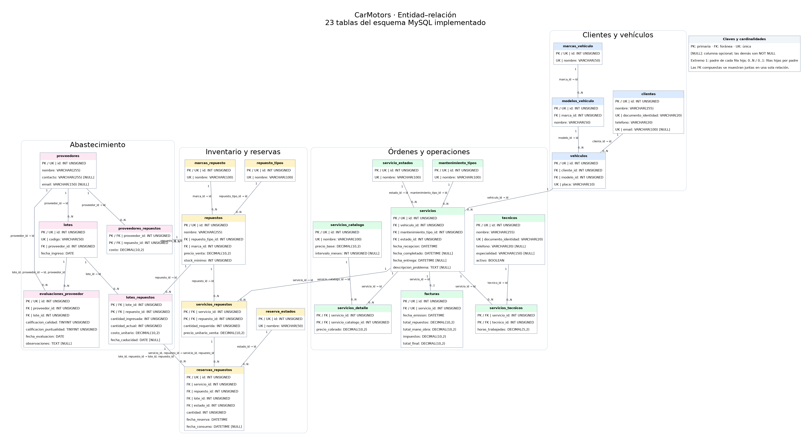

# Sistema de Gestión para el Taller Automotriz CarMotors

Aplicación académica de consola para un taller que necesita reemplazar agendas,
facturas manuales y controles de inventario dispersos. Centraliza clientes,
vehículos, técnicos, órdenes, repuestos, proveedores, facturación e indicadores.
Los usuarios del programa son los empleados y administradores; el cliente es
una entidad de información, no un usuario que inicia sesión.

## Tecnologías y requisitos

- JDK 17 (o posterior compatible con Java 17).
- Maven 3.9 o posterior.
- MySQL Server 8.0.16 o posterior, ejecutado localmente en cada equipo.
- JDBC con MySQL Connector/J 9.5.0.
- JUnit 5 y H2 para pruebas; las pruebas de integración usan MySQL real.

## Instalación

```sh
git clone https://github.com/RickDslayer/proyecto_java_grupo01.git
cd proyecto_java_grupo01
git switch main
```

Inicia MySQL local en el puerto 3306. Desde la raíz del proyecto abre su cliente
con una cuenta administradora:

```sh
mysql -u root -p
```

Ejecuta en este orden:

```sql
SOURCE database/schema.sql;
SOURCE database/data.sql;
```

**`schema.sql` elimina y recrea `carmotors_test`.** Se utiliza para la preparación
inicial o para reiniciar los datos de práctica, no en cada arranque. También crea
el usuario `carmotors_admin` y sus permisos. `data.sql` carga catálogos y ejemplos
relacionados de los distintos módulos.

### Conexión y configuración local

En [ConexionFactory.java](src/main/java/com/carmotors/config/ConexionFactory.java)
están `URL`, `USUARIO` y `CLAVE`. La URL apunta a
`jdbc:mysql://localhost:3306/carmotors_test`; el usuario y la contraseña coinciden
con los declarados al final de `database/schema.sql`. Si se modifica una
credencial o el puerto, hay que actualizar ambos lugares correspondientes y
recompilar. Cada integrante trabaja con su propia instancia de MySQL.

Por acuerdo del equipo la configuración está en código, sin variables de entorno
ni archivos de propiedades. En
[ConfiguracionAplicacion.java](src/main/java/com/carmotors/config/ConfiguracionAplicacion.java)
se configuran:

- `TASA_IMPUESTO`: `0.19` (19 %), tasa de demostración editable del ejercicio.
- `CARPETA_FACTURAS`: `facturas`, relativa al directorio de ejecución.

La tasa se aplica al subtotal de repuestos más mano de obra. Modificarla afecta
solo a facturas nuevas; consultar o exportar una anterior usa sus totales ya
guardados. No se infiere una tasa legal de producción.

### Compilar y ejecutar

```sh
mvn clean verify
mvn compile exec:java -Dexec.mainClass=com.carmotors.Main
```

El programa ofrece dos accesos de demostración:

| Rol | Usuario | Contraseña |
|---|---|---|
| Administrador | `admin` | `demo123` |
| Técnico/empleado | `tecnico` o `empleado` | `demo123` |

Este acceso selecciona la navegación de consola; no implementa cuentas de
empleados en la base de datos. Un técnico selecciona su registro para consultar
sus órdenes. `0` regresa o cancela; los menús indican las excepciones, como
cancelar con ENTER al introducir un importe que puede ser cero.

## Funcionalidades implementadas

### Inventario y abastecimiento

- Repuestos por nombre, tipo y marca, precios, proveedores y stock mínimo.
- Lotes identificados por código, proveedor y fecha de ingreso; cantidades,
  costo y caducidad por línea.
- Stock físico, reservado y disponible; reservas por orden con selección FEFO
  (primero vence, primero sale), excluyendo existencias vencidas.
- Alertas de bajo stock y próxima caducidad; Observer actualiza las alertas
  después de confirmar movimientos.

### Clientes y vehículos

- Registro y consulta de información de contacto, vehículos y propietarios.
- Historial de servicios y operaciones por vehículo o por cliente.
- Recordatorios preventivos calculados desde la última entrega de cada
  operación y su intervalo de meses del catálogo. Se muestran fecha próxima
  y estado pendiente/vencido; no se envían mensajes externos.

### Servicios y técnicos

- Órdenes con vehículo, cliente asociado, tipo preventivo/correctivo y problema.
- Asignación de varios técnicos por orden y varias órdenes por técnico.
- Asignar un técnico a una orden Pendiente la cambia automáticamente a En Proceso
  en la misma transacción.
- Consulta de técnicos con órdenes En Proceso y su cantidad; consulta de técnicos
  sin órdenes abiertas (Pendiente o En Proceso).
- Tiempo acumulativo por pareja orden/técnico: `02:30` + `01:45` = `04:15`.
  Se introduce y muestra como horas:minutos; MySQL conserva DECIMAL(5,2).
- Registro de operaciones del catálogo y precio acordado de mano de obra,
  actualización de precio, retiro y consulta. Se permiten cambios solamente
  mientras la orden está Pendiente o En Proceso.

Las horas del técnico miden duración; **no calculan automáticamente un cobro**.
El cobro procede de los precios registrados por operación. Una operación gratuita
puede tener precio cero; repetir el registro de la misma operación se rechaza y
su precio se modifica mediante la opción de actualización.

### Reserva, finalización y facturación

```text
Crear orden → Pendiente
Asignar técnico → En Proceso
Registrar operaciones, horas y repuestos reservados
Completar → Completado (consume las reservas y descuenta el stock físico)
Facturar → Facturado (guarda factura y genera TXT)
Entregar → Entregado
```

Reservar no descuenta stock físico, pero reduce el disponible. Al completar, el
consumo y el cambio de estado se confirman juntos. Repetir la finalización no
vuelve a descontar. La facturación exige una orden Completado y permite una sola
factura por orden; la entrega exige una factura registrada.

La factura incluye cliente, documento/contacto, vehículo (marca/modelo/placa),
repuestos con cantidad, precio e importe, operaciones de mano de obra,
subtotal, impuesto y total. Se utilizan precios registrados en la orden y totales
persistidos, no los precios actuales del catálogo. El impuesto se redondea a dos
decimales con HALF_UP.

El TXT UTF-8 se guarda después del commit de la factura en
`facturas/factura-ID-orden-ID.txt`. Si falla el archivo, la factura sigue en MySQL;
la opción **Facturación → Exportar nuevamente una factura TXT** permite elegir
otra carpeta y reintentar. No se sobrescriben archivos existentes. La opción de
consulta permite ver el documento sin generar un archivo.

### Reportes gerenciales

Los tres reportes están disponibles en el menú de administrador y aceptan fecha
inicial/final inclusivas y orden por cantidad o nombre:

| Reporte | Métrica y fecha utilizada |
|---|---|
| Servicios solicitados | Cantidad de órdenes por tipo de mantenimiento y fecha de recepción, en cualquier estado. |
| Productividad por técnico | Participaciones en órdenes completadas, facturadas o entregadas, según fecha de completado. |
| Consumo de repuestos | Unidades de reservas CONSUMIDAS según fecha de consumo. |

Una orden con dos técnicos suma una participación para cada uno. La productividad
cuenta participaciones, no horas por orden ni rentabilidad; incluye asignaciones
con cero horas y técnicos actualmente inactivos. Los servicios solicitados se
agrupan en Preventivo/Correctivo; no representan un ranking de cada operación
del catálogo ni un análisis de ganancias.

### Proveedores

Información de contacto, catálogo proveedor–repuesto con costo de compra y
evaluaciones de calidad/puntualidad asociadas a sus lotes.

## Modelo de datos



- `clientes` → `vehiculos`; marcas y modelos se normalizan en catálogos.
- `servicios` relaciona vehículo, tipo de mantenimiento y estado.
- `servicios_tecnicos` une órdenes y técnicos y conserva sus horas acumuladas.
- `servicios_catalogo` define trabajos, precios base e intervalos preventivos;
  `servicios_detalle` guarda cada operación y su precio cobrado en una orden.
- `repuestos`, tipos y marcas describen los productos; `proveedores_repuestos`
  mantiene las ofertas de cada proveedor.
- `lotes` y `lotes_repuestos` guardan origen, cantidades, costos y caducidad.
- `servicios_repuestos` guarda cantidades y precios de venta de la orden;
  `reservas_repuestos` identifica los lotes y el estado de cada reserva.
- `facturas` conserva una factura única por servicio y sus totales.
- `evaluaciones_proveedor` conserva las evaluaciones de sus entregas.

Estructura completa en [database/schema.sql](database/schema.sql) y datos de
práctica en [database/data.sql](database/data.sql).

### Diagramas de la implementación

- [Diagrama de clases principales](docs/diagrama-clases.png): nombres, atributos
  y métodos contrastados con el código Java. Los modelos mantienen vínculos por
  identificadores; se distinguen dependencias, herencia e interfaces.
- [Diagrama entidad–relación](docs/diagrama-er.png): las 23 tablas, columnas,
  claves simples/compuestas y relaciones de `schema.sql`.
- [Arquitectura](docs/arquitectura.png): consola, controladores, servicios,
  modelo, Factory Method, DAO/JDBC, MySQL local y exportación TXT.

En `docs` se conserva una sola imagen por diagrama. El diagrama de clases
muestra las clases principales y contratos, con parámetros y métodos auxiliares
omitidos; no pretende listar todas las clases del proyecto.

## Arquitectura, SOLID y patrones

```text
vista → controlador → servicio → dao → MySQL
                         ↓
                       modelo
```

`Main` ensambla las dependencias. Las vistas leen y presentan; los controladores
adaptan entradas; los servicios validan y coordinan transacciones; los DAO reciben
la conexión y ejecutan SQL con PreparedStatement. El servicio que abre una conexión
la cierra y decide commit/rollback.

| Patrón | Aplicación |
|---|---|
| Singleton | `ConexionFactory` comparte configuración; cada llamada crea una conexión independiente. |
| DAO | Interfaces y productos JDBC encapsulan consultas y persistencia. |
| Factory Method | `DAOFactory.obtenerDAO()` invoca `crearDAO()` y cada subclase selecciona su producto JDBC. Incluye los DAO nuevos de catálogo y operaciones. |
| Strategy | `ReporteStrategy` y sus implementaciones de servicios, productividad y consumo. |
| Observer | `PublicadorInventario` notifica a `AlertasInventarioService` después del commit. |

Aplicación de SOLID:

- **SRP:** consulta de factura, cálculo, exportación, navegación y persistencia
  tienen responsabilidades separadas.
- **OCP:** un nuevo reporte implementa `ReporteStrategy`; un nuevo creador
  extiende `DAOFactory`.
- **LSP:** las implementaciones JDBC y los dobles de prueba respetan los contratos
  DAO sin exigir cambios a sus consumidores.
- **ISP:** contratos específicos como `FacturacionOrden`, `ConsumoReservasOrden`
  y DAO especializados evitan una interfaz universal.
- **DIP:** los servicios reciben interfaces DAO y proveedores de conexiones.

Se utilizan lambdas, referencias a métodos y Streams para agregación de reportes,
filtros de asignaciones, recordatorios y presentación de colecciones.

## Verificación de la entrega

`main` contiene la aplicación y los dos scripts SQL. Las pruebas automatizadas,
el simulador y los documentos de desarrollo permanecen en `developer`.

Para compilar la entrega:

```sh
mvn clean verify
```

Para ejecutar las pruebas con MySQL preparado según las instrucciones anteriores:

```sh
git switch developer
mvn verify
git switch main
```

En `main`, `verify` comprueba la compilación y el empaquetado; no ejecuta pruebas
porque `src/test` se conserva únicamente en `developer`. Allí están las pruebas
de consola y el recorrido integrado de cliente hasta entrega, además de rollback,
consumo único de stock, horas acumuladas, facturación concurrente y exportación.

## Organización del repositorio

```text
src/main/java/com/carmotors/
  Main.java
  vista/  controlador/  modelo/  servicio/  dao/  config/  excepcion/
database/
  schema.sql
  data.sql
docs/
  diagrama-clases.png
  diagrama-er.png
  arquitectura.png
pom.xml
README.md
.gitignore
```

`main` contiene la entrega de la aplicación; `developer` conserva la integración,
las pruebas y la documentación de desarrollo. `.gitignore` excluye `/target/`, `*.class`,
archivos de IDE, `*.log` y la carpeta local de facturas generadas.

## Autores

- Ricardo Vargas — [RickDslayer](https://github.com/RickDslayer)
- Jesus Salcedo — [tecnicajesus](https://github.com/tecnicajesus)
- Yonder
- Brayan Medina — [bramema](https://github.com/bramema)
